# RAMCOSPLY - Aplikasi Penyewaan Kostum

## Deskripsi Singkat
RAMCOSPLY adalah aplikasi mobile yang memungkinkan pengguna untuk menyewa berbagai macam kostum dan aksesoris cosplay. Aplikasi ini dirancang dengan antarmuka yang elegan dan modern, dilengkapi dengan sistem otentikasi, katalog produk yang dinamis, serta panel admin yang fungsional untuk manajemen produk dan penyewaan.

## Fitur Aplikasi

### Fitur Pengguna (User)
-   **Otentikasi Pengguna**:
   -   Sistem **Login** dan **Registrasi** yang aman menggunakan **Firebase Authentication** (Email & Password).
   -   Status login disimpan secara lokal menggunakan **Shared Preferences**, sehingga pengguna tetap masuk saat aplikasi dibuka kembali.
### Tampilan LOGIN
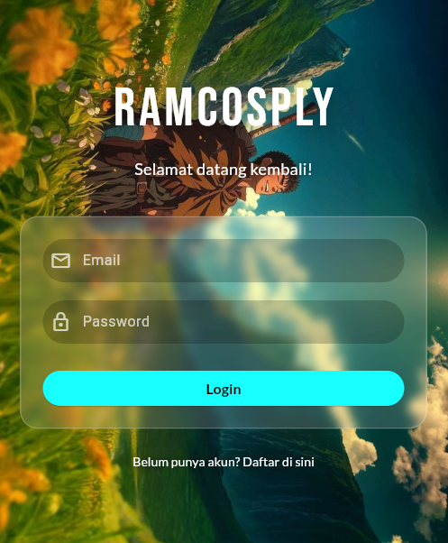
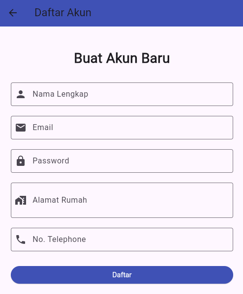
  
- **Katalog Produk**:
   -   **Pencarian (Search)**: Pengguna dapat mencari item berdasarkan nama.
   -   **Filter Lanjutan**: Memfilter produk berdasarkan kategori ("Baju", "Aksesoris") dan ketersediaan ("Hanya tampilkan yang tersedia").
   -   **Tampilan Produk Elegan**: Desain kartu produk yang modern dengan informasi harga yang diformat, rating bintang, dan jumlah ulasan.
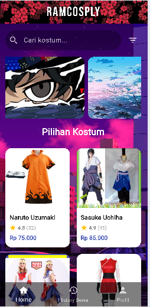 
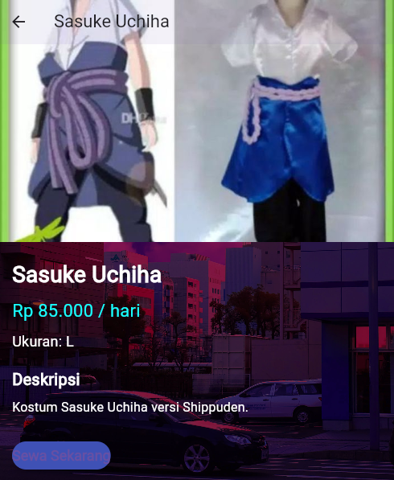
- **Proses Penyewaan**:
   -   Pengguna dapat melihat detail lengkap setiap item, dengan transisi gambar yang mulus menggunakan **Hero Animation**.
   -   **Pemilihan Ukuran**: Pengguna dapat memilih ukuran yang tersedia untuk setiap kostum sebelum menyewa.
   -   **Pemilihan Tanggal**: Kalender interaktif untuk memilih tanggal mulai dan selesai sewa.
   -   **Konfirmasi & Transaksi**: Dialog konfirmasi menampilkan rincian pesanan sebelum transaksi disimpan. 
 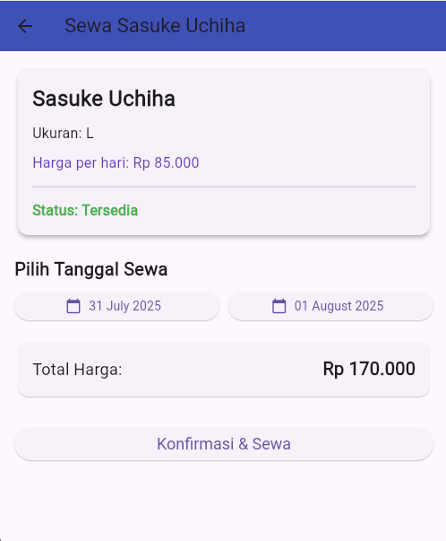
 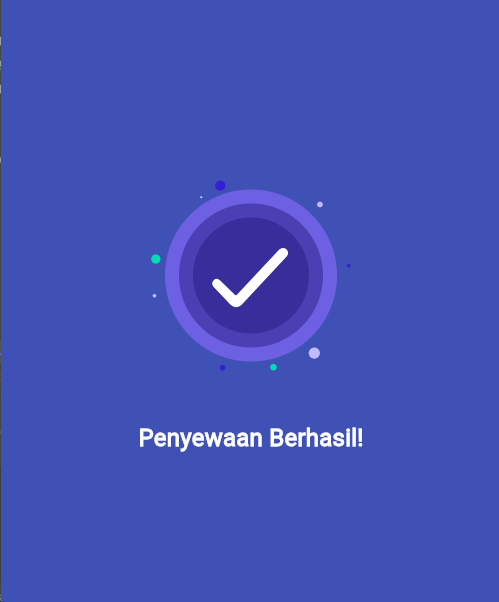
- **Riwayat Sewa**:
   -   Semua transaksi sewa secara otomatis disimpan ke **Cloud Firestore**.
   -   Pengguna dapat melihat daftar riwayat penyewaan mereka, yang diurutkan dari yang terbaru.
   -   Setiap item riwayat dapat diklik untuk melihat halaman detail transaksi yang lengkap.
   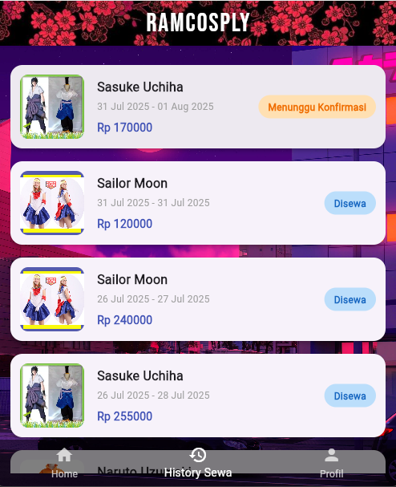
   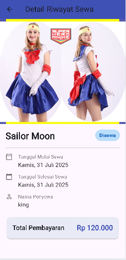
-   **Manajemen Profil**:
   -   Pengguna dapat melihat data profil mereka (nama, email, alamat, no. telepon).
   -   Terdapat halaman khusus untuk **mengedit informasi profil** yang akan diperbarui secara real-time di Firestore.
   -   Tombol logout yang aman di halaman profil.
   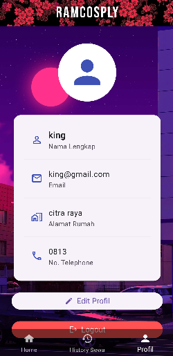

### Fitur Admin
-   **Panel Admin Eksklusif**:
   -   Akses ke panel admin dibatasi hanya untuk pengguna dengan status `isAdmin` di Firestore.
   -   Tombol "Panel Admin" hanya muncul di halaman profil jika pengguna adalah admin.
   -   Navbar admin disesuaikan secara dinamis (menghilangkan tab "History Sewa").
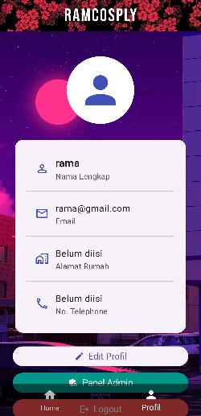

-   **Manajemen Produk (CRUD)**:
   -   Admin dapat **menambah** item baru (baju/aksesoris) melalui form di aplikasi.
   -   Admin dapat **mengedit** detail item yang sudah ada.
   -   Admin dapat **menghapus** item dari katalog.
   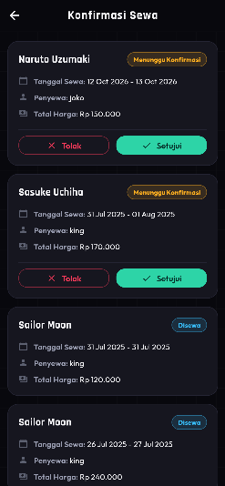
-   **Manajemen Ketersediaan**:
   -   Saat pengguna menyewa barang, statusnya otomatis berubah menjadi "Tidak Tersedia" (disimulasikan di dalam aplikasi).
   -   Admin memiliki halaman khusus untuk **mengubah status ketersediaan** barang melalui tombol *switch*.
   -   Admin dapat melihat semua daftar permintaan sewa dari seluruh pengguna.
   -   Admin dapat menyetujui atau menolak permintaan sewa, yang akan mengubah status transaksi di Firestore.
   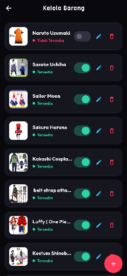
### LOGIN SEBAGAI ADMIN
- **NAME:rama@gmail.com**
- **PASSWORD:123456**

### UI/UX & Animasi
-   **Desain Elegan**:
   -   Halaman login dengan latar belakang anime, judul kustom, dan form input dengan efek **Glassmorphism** (kaca buram).
   -   Header aplikasi kustom dengan judul "RAMCOSPLY", font `Google Fonts`, dan latar belakang gambar lokal.
   -   Desain kartu produk yang premium dan estetis.
-   **Banner Otomatis**: Banner gambar di halaman utama yang dapat **bergeser secara otomatis** setiap beberapa detik.
-   **Layout Interaktif**:
   -   Seluruh konten di halaman utama, termasuk search bar dan banner, dapat **digulir (scroll)** bersama sebagai satu kesatuan.
   -   Navbar bawah dibuat **transparan** agar menyatu dengan latar belakang aplikasi.
-   **Animasi Transaksi**: Menampilkan **animasi Lottie** yang menarik saat transaksi penyewaan berhasil, memberikan feedback visual yang memuaskan kepada pengguna.

## Teknologi yang Digunakan
-   **Framework**: Flutter
-   **State Management**: Provider
-   **Backend & Database**:
   -   **Firebase Authentication**: Otentikasi pengguna.
   -   **Cloud Firestore**: Database untuk data pengguna dan riwayat transaksi.
   -   **JSON Server**: Simulasi REST API untuk katalog produk.
-   **Penyimpanan Lokal**: Shared Preferences
-   **Animasi**: Hero Animation, Lottie
-   **Lainnya**: `intl` untuk format rupiah, `google_fonts` untuk tipografi.


## Cara Menjalankan Aplikasi

> **Penting:** Data katalog kostum/aksesoris diambil dari **JSON Server lokal** (`http://localhost:3000`). Jika backend belum dijalankan, katalog akan tampil kosong / muncul pesan "Gagal memuat data". Jalankan backend **lebih dulu** sebelum menjalankan aplikasi.

### 1. Prasyarat
-   [Flutter SDK](https://docs.flutter.dev/get-started/install) (sudah terpasang & terdaftar di PATH)
-   [Node.js](https://nodejs.org/) (versi 18 atau lebih baru)

### 2. Install dependensi Flutter
```bash
flutter pub get
```

### 3. Jalankan backend JSON Server
Buka terminal baru, masuk ke folder proyek, lalu jalankan:

```bash
npx json-server --watch db.json --port 3000
```

Server akan aktif di `http://localhost:3000`. Endpoint katalog dapat diakses di `http://localhost:3000/baju`. Server akan otomatis memantau (watch) perubahan pada file `db.json`.

> **Catatan Windows:** Jika `npm.ps1` diblokir oleh kebijakan *Execution Policy*, gunakan `npm.cmd` sebagai gantinya. Jika `json-server` sudah terpasang secara global, cukup jalankan:
> ```powershell
> json-server --watch db.json --port 3000
> ```

### 4. Jalankan aplikasi Flutter
Buka terminal lain, masuk ke folder proyek, lalu jalankan di browser:

```bash
flutter run -d chrome
```

Setelah aplikasi terbuka, data katalog akan otomatis dimuat dari backend. Lakukan *refresh* (F5) pada browser jika data belum muncul.


## Kontributor
- **Nama:Rama Aditya Sutisna** 
- **NIM:2022804054** 