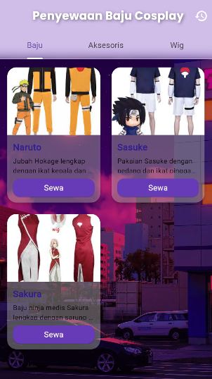
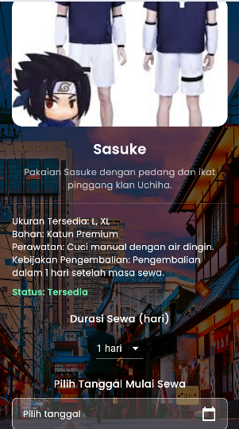

# 👘 Aplikasi Penyewaan Baju Cosplay
Developer
- Nama: Rama Aditya Sutisna
- NPM: 2022804054
- Kelas: SI 6B
- Mata Kuliah: Pemrograman Mobile

Aplikasi Flutter untuk menyewa kostum cosplay lengkap dengan fitur interaktif, tampilan menarik, dan manajemen data yang efisien.
Dibuat untuk memenuhi Ujian Tengah Semester Pemrograman Mobile.

---
## 📸 Preview

### Tampilan Beranda


### Detail Kostum

## ✨ Fitur Utama

- 🔒 **Login** dengan username(admin) dan Password (123456)
- 🏠 **Beranda** dengan kategori (Baju, Aksesoris, Wig)
- 🎨 **Galeri Gambar Kostum** (Carousel)
- 📄 **Detail Kostum**: ukuran, bahan, perawatan, kebijakan pengembalian
- 📅 **Pilih Tanggal & Durasi Sewa**
- ✅ **Cek Ketersediaan Kostum**
- 🧾 **Riwayat Penyewaan**
- 💡 **UI/UX modern dan ramah pengguna**

---

## 🚀 Cara Menjalankan Proyek

1. Clone repository:
   ```bash
   git clone https://github.com/senseialing/UTS.git
